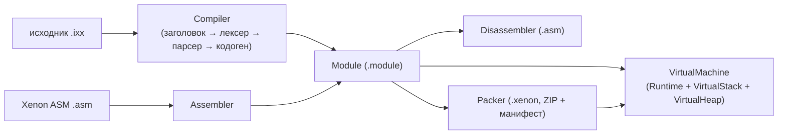

> [!WARNING]
> 🤖 Проект разработан с использованием ИИ-ассистента **DeepSeek** (DeepSeek V4 Pro).

# XenonCLI

Компактная система выполнения по образцу Java/.NET. **Xenon** компилирует
C++-подобный язык (модули `.ixx`) в собственный бинарный код, упаковывает его в
`.module`/`.xenon` и исполняет на виртуальной машине.



## Ключевая идея: единое представление Xenon ASM

Всё, что компилятор создаёт и что исполняет VM, описывается **одной моделью**
(`xenon/asm/model.hpp`):

- исполняемый код — функции и методы с телами `XenonBinary`;
- данные — классы, структуры, перечисления, поля и глобальные переменные;
- метаданные — атрибуты, шаблонные параметры, наследование и модификаторы
  доступа.

Текстовый Xenon ASM (`.asm`) и бинарный формат `.module` — два представления
этой модели. Ассемблер и дизассемблер замыкают цикл, поэтому один и тот же
артефакт можно прочитать, отредактировать и собрать заново.

## Подпроекты

| Подпроект | Цель сборки | Назначение |
| --- | --- | --- |
| `xenon.core` | `xenon_core` | Xenon ASM (`Instruction`, `Module`, `XenonBinary`), лексер/парсер/кодоген, формат `.module`, исполнитель (`Runtime`, `VirtualMachine`, `VirtualStack`, `VirtualHeap`) |
| `xenon.env` | `xenon_env` | среда классов Xenon: `Object`, `String`, `Vector<Type>`, `Environment` и встроенный модуль `xenon.env` |
| `xenon.packer` | `xenon_packer` | упаковщик `.module`/`.hint` в `.xenon` (ZIP + `META-INF/MANIFEST.MF`) |
| `xenon` | `xenon` | CLI: `compile`, `asm`, `disasm`, `run`, `pack` |

Зависимости: `xenon.env` → `xenon.core`, `xenon.packer` → `xenon.core`,
`xenon` → все три библиотеки.

## Скрипты: модули `.ixx`

Скрипт — модуль, похожий на интерфейсный модуль C++20 (`.ixx`). Один файл
`.ixx` компилируется в один файл `.module`.

```cpp
// examples/example.ixx
export module Example;    // 1) объявление модуля (обязательно, первым)

import Math;              // 2) зависимости модуля
import IO.Core;

#include "xenon/xenon.hpp" // 3) инклуды хост-окружения

double add(double a, double b) // 4) тело: обычный C++-подобный код
{
    return a + b;
}

double main()
{
    return add(20.0, 22.0);
}
```

| Элемент | Назначение |
| --- | --- |
| `export module Name;` | имя модуля; обязателен и должен идти первым |
| `import Name;` | зависимость от другого модуля |
| `#include ...` | текстовый инклуд (содержимое вставляется на место директивы) |
| `export` | помечает символы/объявления, видимые за пределами модуля |

Скомпилированный модуль содержит функции, методы, типы, перечисления,
шаблоны и глобальные переменные. Импорты разрешаются на этапе выполнения:
инструкции `call`, `new`, `ldg`/`stg` ссылаются на **имена**, а VM связывает
их с загруженными модулями и нативными функциями.

## Xenon ASM

```asm
.meta
    .module Demo
.end

.text
    .function export double main()
        const 3.5
        const 2.0
        mul
        ret
    .end
.end
```

```sh
xenon asm demo.asm -o demo.module
xenon disasm demo.module
```

Полное описание синтаксиса, директив и инструкций — в
[docs/xenon-asm.md](docs/xenon-asm.md).

## Среда выполнения (исполнитель)

Исполнитель построен по образцу Java C++ API (JNI): класс `Runtime` хранит
массив объектов `Module` и предоставляет окружение, через которое хост
взаимодействует с виртуальной машиной.

```cpp
xenon::Runtime runtime;

runtime.addModule(xenon::environmentModule()); // встроенный модуль xenon.env
runtime.loadModuleFile("example.module");

xenon::Ref point = runtime.newObject("Point");
runtime.setField(point, "x", 1.5);
xenon::Ref s = runtime.newString("hello");

int code = runtime.runMain("main", {"a", "b"}, {}); // запуск точки входа
```

| Компонент | Назначение |
| --- | --- |
| `Runtime` | исполнитель: массив модулей, API объектов/полей/стек, запуск |
| `VirtualStack` | стек операндов виртуальной машины |
| `VirtualHeap` | управляемая куча: объекты, массивы, строки |
| `VirtualMachine` | исполняет `XenonBinary`, связывает имена функций/типов/глобалов |
| `XenonBinary` | поток инструкций + пулы констант и строк |

## Командная строка

```
xenon                                    версия и справка
xenon help                               справка
xenon version                            версия
xenon compile <source.ixx> [hints...] [-o <module>]
                                         скомпилировать .ixx + .hint в .module
xenon asm <source.asm> [-o <module>]     собрать текстовый Xenon ASM
xenon disasm <module> [-o <listing.asm>] дизассемблировать .module
xenon run <package.xenon> [args...]      запустить .xenon (точка входа из манифеста)
xenon run <module> [function] [args...]  запустить функцию/метод (по умолчанию main)
xenon pack <modules...> <package.xenon> [manifest]
                                         упаковать модули в .xenon
```

### Сигнатуры запускаемой функции

Возвращаемое значение — целое (код завершения) или `void`. Поддерживаются:

```cpp
int main(void);
int main(int argc, char* argv[]);
int main(int argc, char* argv[], char* envp[]);
int main(xenon::Vector<xenon::String> arguments);
int main(xenon::Vector<xenon::String> arguments, xenon::Vector<xenon::String> environment);
```

`argv`/`envp` передаются как массивы строк на куче виртуальной машины.

## Стиль кода

- Открывающая фигурная скобка — на новой строке.
- Классы, структуры, перечисления, значения перечислений, глобальные переменные,
  шаблоны и публичные поля — с заглавной буквы, слитно: `ExampleSymvolName`.
- Функции, методы, локальные переменные — с маленькой буквы, слитно:
  `exampleSymvolName`.
- Приватные поля — с подчёркивания: `_exampleSymvolName`.
- Индентация — табуляция; см. [docs/style-guide.md](docs/style-guide.md).

## Сборка и запуск

```sh
cmake --preset x64-debug        # Windows; linux-debug / macos-debug на других ОС
cmake --build --preset x64-debug
ctest --preset x64-debug

./out/build/x64-debug/xenon compile examples/sqrt_demo.ixx examples/math.hint
./out/build/x64-debug/xenon run examples/sqrt_demo.module
```

Подробнее — в [docs/building.md](docs/building.md).

## Структура

```
XenonCLI/
├── CMakeLists.txt
├── CMakePresets.json          # configure + build + test presets
├── .clang-format / .clang-tidy / .editorconfig
├── .github/
│   ├── workflows/ci.yml       # MSVC / GCC / Clang
│   └── skills/github-cli/     # работа с GitHub через gh
├── include/xenon/
│   ├── core/                  # определения препроцессора
│   ├── asm/                   # Instruction, Module, XenonBinary, ассемблер, дизассемблер
│   ├── compiler/              # заголовок модуля, лексер, парсер (AST), кодогенератор
│   ├── module/                # формат .module
│   ├── runtime/               # Runtime, VM, стек, куча, значения
│   ├── env/                   # Object, String, Vector, Environment
│   └── packer/                # Packer, Manifest (.xenon)
├── src/                       # реализации (зеркально include/) + src/cli/main.cpp
├── tests/                     # юнит-тесты (CTest)
├── examples/                  # примеры .ixx, .hint и .asm
└── docs/                      # документация
```
