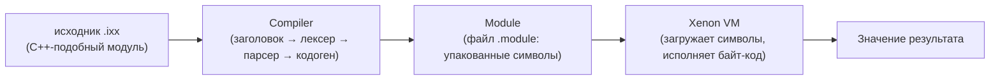

# XenonCLI

Среда выполнения (runtime) для скриптов в C++-подобном синтаксисе. Исходный текст
(`.ixx`) транслируется в упакованный бинарный артефакт — файл **`.module`**, а
**Xenon VM** загружает из него символы (классы, функции, структуры, шаблоны,
перечисления) и исполняет их.

> Реализованы: формат `.module`, среда выполнения (`Env`), компилятор подмножества
> C++-подобного языка (функции, `if`/`while`, выражения) и VM с вызовами функций.

> 🤖 Проект разработан с использованием ИИ-ассистента **DeepSeek** (DeepSeek V4 Pro).

## Архитектура



Модули:

| Модуль | Назначение |
| --- | --- |
| `bytecode` | `OpCode`, `Chunk` — байт-код тела функции, дизассемблер |
| `module` | `Symbol`, `Module`, сериализация/загрузка `.module` |
| `runtime` | `Value`, `Env` (куча, объекты, стек), `VM` (исполнение) |
| `compiler` | фронт-энд: лексер, парсер (AST), кодогенератор `.ixx` → `.module` |

## Скрипты: модули `.ixx`

Скрипт — это модуль, похожий на интерфейсный модуль C++20 (`.ixx`).
Структура файла:

```cpp
// examples/example.ixx
export module Example;    // 1) объявление модуля (обязательно, первым)

import Math;              // 2) зависимости модуля (как `using`/`import` в C#)
import IO.Core;

#include "xenon/xenon.hpp" // 3) инклуды хост-окружения

export int add(int a, int b) // 4) тело: обычный код
{
    return a + b;
}

int private_helper(int x) // без `export` — не виден снаружи
{
    return x * 2;
}
```

Правила:

| Элемент | Назначение |
| --- | --- |
| `export module Name;` | объявляет имя модуля; обязателен и должен идти первым |
| `import Name;` | зависимость от другого модуля (аналог `using` в C#) |
| `#include ...` | текстовый инклуд заголовка хост-окружения |
| `export` | помечает объявления, видимые потребителям модуля |

Видимость компонентов модуля определяется ключевым словом `export`: всё, что
идёт без `export`, остаётся приватным внутри модуля.

## Артефакт: файлы `.module`

Скомпилированный модуль сохраняется в бинарный файл `.module`. Внутри него —
упакованные символы, которые экспортирует модуль:

| Тип символа | Что содержит |
| --- | --- |
| `Function` | сигнатуру и упакованный байт-код тела |
| `Class` / `Struct` | поля и методы (упакованное описание) |
| `Enum` | перечислители |
| `Template` | параметризованное описание |
| `Variable` | глобальные переменные / константы |

Среда выполнения загружает символы из `.module` и исполняет функции.

## Среда выполнения (API)

Полноценная среда выполнения построена по образцу JNI (Java C++ API): объект
`Env` — это «окружение», через которое хост взаимодействует с VM.

```cpp
xenon::Env env;                          // среда выполнения (аналог JNIEnv)

// куча: объекты, массивы, строки
xenon::Ref point = env.new_object("Point");
env.set_field(point, "x", 1.5);
env.set_field(point, "y", 2.5);
xenon::Ref xs = env.new_array(3);
env.set_element(xs, 0, 10.0);
xenon::Ref s = env.new_string("hello");

// стек операндов
env.push(1.2);
env.push(env.get_field(point, "x"));
double top = std::get<double>(env.pop());

// исполнение
env.load(module);
env.run("add");
xenon::Value result = env.last_value();
```

Основные компоненты среды:

| Компонент | Назначение |
| --- | --- |
| `Env` | API окружения: объекты, поля, массивы, строки, стек, запуск |
| `Heap` | управляемая куча: хранит все объекты, выдаёт `Ref` |
| `Object` | объект на куче: `Object` (поля), `Array`, `String` |
| `Value` | значение: `double`, `bool`, `null`, `Ref` |
| `VM` | движок исполнения: байт-код поверх внешнего стека |

Методы `Env` (JNI-подобные): `new_object`, `new_array`, `new_string`,
`set_field`/`get_field`, `set_element`/`get_element`, `array_length`,
`string_value`, `push`/`pop`/`peek`/`stack_size`, `load`/`run`/`run_chunk`,
`is_number`/`is_boolean`/`is_null`/`is_ref`.

## Язык

Компилятор поддерживает подмножество C++-подобного синтаксиса:

```cpp
export module Example;

double factorial(double n)   // функция с параметрами и локальными переменными
{
    double result = 1.0;
    double i = 1.0;
    while (i <= n)            // цикл while
    {
        result = result * i;
        i = i + 1.0;
    }
    return result;
}

double main()
{
    if (factorial(5.0) == 120.0)   // if/else и вызовы функций
    {
        return 1.0;
    }
    return 0.0;
}
```

Поддерживается:

| Возможность | Пример |
| --- | --- |
| Типы | `int`, `double`, `bool`, `void` |
| Литералы | `1.5`, `true`, `false`, `null` |
| Выражения | `+ - * /`, `== != < <= > >=`, `&& \|\|`, `!`, `-x` |
| Присваивание | `x = expr` |
| Объявления | `double x = 1.0;` |
| Управление | `if`/`else`, `while`, `return` |
| Функции | объявление и вызов `f(a, b)` |

Строки и классы/структуры — на следующем этапе.

## Структура

```
XenonCLI/
├── CMakeLists.txt
├── CMakePresets.json
├── include/xenon/        # публичные заголовки
│   ├── bytecode/
│   ├── compiler/
│   ├── module/
│   └── runtime/
├── src/                  # реализация
│   ├── bytecode/
│   ├── compiler/
│   ├── module/
│   ├── runtime/
│   └── main.cpp          # CLI
├── tests/                # юнит-тесты (CTest)
└── examples/             # примеры скриптов
```

## Требования

- CMake ≥ 3.24
- Компилятор с поддержкой C++23 (`std::format`):
  - MSVC ≥ 19.34 (VS 2022 17.4+)
  - GCC ≥ 13
  - Clang ≥ 17

## Сборка

Через пресеты:

```sh
cmake --preset default
cmake --build --preset default
ctest --preset default
```

Либо вручную:

```sh
cmake -S . -B build -DCMAKE_BUILD_TYPE=Debug
cmake --build build
ctest --test-dir build
```

## Запуск

Без аргументов — демонстрация: модуль с функцией `add` упаковывается в `.module`,
перечитывается и исполняется на VM:

```sh
./build/default/xenon
```

Со скриптом `.ixx` — модуль компилируется в `.module` и исполняется (функция
`main` или первая функция модуля):

```sh
./xenon examples/example.ixx
```

С готовым артефактом — загрузка символов из файла `.module` и их исполнение:

```sh
./xenon path/to/module.module
```

## Байт-код

Байт-код хранится внутри символа `Function` в `.module`-файле. Каждая
инструкция — однобайтовый опкод; у `Constant` — однобайтовый операнд (индекс в
пуле констант, до 256 констант на `Chunk` — временное ограничение).

| Опкод | Действие |
| --- | --- |
| `Constant` | положить константу на стек |
| `LoadLocal` / `StoreLocal` | чтение / запись локальной переменной |
| `Add` / `Subtract` / `Multiply` / `Divide` | бинарные арифметические операции |
| `Negate` / `Not` | унарные операции |
| `Equal` / `NotEqual` / `Less` / ... | сравнения |
| `Jump` / `JumpIfFalse` | переходы (для `if`/`while`) |
| `Call` | вызов функции |
| `Return` | снять вершину стека и завершиться с результатом |

## Дорожная карта

- [x] Каркас CMake-проекта (C++23, библиотека + CLI + CTest)
- [x] Байт-код: `OpCode`, `Chunk`, дизассемблер
- [x] Стековая VM и тип `Value`
- [x] Концепт модуля `.ixx` и парсер заголовка (`export module`/`import`/`#include`)
- [x] Артефакт `.module`: `Symbol`, `Module`, сериализация и загрузка символов в VM
- [x] Среда выполнения: `Env` (куча, объекты, стек), API в стиле JNI
- [x] Лексер и парсер C++-подобного синтаксиса (AST)
- [x] Кодогенератор (`.ixx` → символы в `.module`)
- [x] Функции, локальные переменные, `if`/`while`, вызовы функций
- [ ] Строки, классы/структуры, встроенные функции

## Лицензия

BSD 3-Clause — см. [LICENSE.txt](LICENSE.txt).
