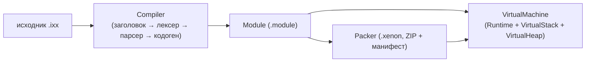

<div align="center">

**⚠️ ВНИМАНИЕ:** 🤖 Проект разработан с использованием ИИ-ассистента **DeepSeek** (DeepSeek V4 Pro).

</div>

# XenonCLI

Компактная система выполнения по образцу Java/.NET. **Xenon** компилирует
C++-подобный язык (модули `.ixx`) в собственный бинарный код, упаковывает его в
`.module`/`.xenon` и исполняет на виртуальной машине.



## Подпроекты

| Подпроект | Цель сборки | Назначение |
| --- | --- | --- |
| `xenon.core` | `xenon_core` | базовые классы, структуры, перечисления, определения препроцессора: байт-код (`XenonBinary`, `OpCode`), значения, `Module`/`Symbol`, формат `.module`, фронт-энд компилятора, исполнитель (`Runtime`, `VirtualMachine`, `VirtualStack`, `VirtualHeap`) |
| `xenon.env` | `xenon_env` | среда классов Xenon: `Object`, `String`, `Vector<Type>`, `Environment` и встроенный модуль `xenon.env` |
| `xenon` | `xenon` | исполняемая программа: компилирует, упаковывает и выполняет байт-код (компоненты `compiler`, `executor`, `packer`) |

## Скрипты: модули `.ixx`

Скрипт — модуль, похожий на интерфейсный модуль C++20 (`.ixx`). Один файл
`.ixx` компилируется в один файл `.module`.

```cpp
// examples/example.ixx
export module Example;    // 1) объявление модуля (обязательно, первым)

import Math;              // 2) зависимости модуля
import IO.Core;

#include "xenon/xenon.hpp" // 3) инклуды хост-окружения

double add(double a, double b) // 4) тело: обычный C++-подобный код
{
    return a + b;
}

double main()
{
    return add(20.0, 22.0);
}
```

| Элемент | Назначение |
| --- | --- |
| `export module Name;` | имя модуля; обязателен и должен идти первым |
| `import Name;` | зависимость от другого модуля |
| `#include ...` | текстовый инклуд (содержимое вставляется на место директивы) |
| `export` | помечает символы/объявления, видимые за пределами модуля |

Файл `.module` содержит **символы**: функции, классы, структуры, перечисления,
шаблоны и глобальные переменные.

## Артефакт: файлы `.module`

Скомпилированный модуль сохраняется в бинарный файл `.module` (разметка в духе
COFF/PE). Внутри — упакованные символы, которые экспортирует модуль.

## Среда выполнения (исполнитель)

Исполнитель построен по образцу Java C++ API (JNI): класс `Runtime` хранит
массив объектов `Module` и предоставляет окружение, через которое хост
взаимодействует с виртуальной машиной.

```cpp
xenon::Runtime runtime;

runtime.addModule(xenon::environmentModule()); // встроенный модуль xenon.env
runtime.loadModuleFile("example.module");

xenon::Ref point = runtime.newObject("Point");
runtime.setField(point, "x", 1.5);
xenon::Ref s = runtime.newString("hello");

int code = runtime.runMain("main", {"a", "b"}, {}); // запуск точки входа
```

| Компонент | Назначение |
| --- | --- |
| `Runtime` | исполнитель: массив модулей, API объектов/полей/стек, запуск |
| `VirtualStack` | стек операндов виртуальной машины |
| `VirtualHeap` | управляемая куча: объекты, массивы, строки |
| `VirtualMachine` | исполняет бинарный код `XenonBinary` |
| `XenonBinary` | бинарный код (опкоды + пул констант + номера строк) |

Модули можно загрузить из файла `.module` или создать вручную. Содержимое
символов (поля классов и т. д.) можно менять во время выполнения.

## Библиотека среды `xenon.env`

`xenon.env` задаёт основу Xenon API — классы, наследуемые от `Object`:

| Класс | Назначение |
| --- | --- |
| `Object` | базовый класс с виртуальными методами `getType`, `getHash`, `toString` |
| `String` | строка |
| `Vector<Type>` | динамический список |
| `Environment` | хранит и управляет классами среды; сам наследуется от `Object` |

Для библиотеки реализован встроенный модуль `environmentModule()`, который можно
добавить в `Runtime`.

## Упаковщик: файлы `.xenon`

`Packer` упаковывает файлы `.module` и `.hint` в ZIP-архив с расширением
`.xenon` (как Jar), создавая и настраивая манифест `META-INF/MANIFEST.MF`:

```
Manifest-Version: 1.0
Main-Module: Example
Main-Function: main
```

## Командная строка

```
xenon                                    версия и справка
xenon help                               справка
xenon version                            версия
xenon compile <sources>... [module]      скомпилировать .ixx + .hint в .module
xenon run <xenon> <arguments>...         запустить .xenon (точка входа из манифеста)
xenon run <module> <function/method> <arguments>...
                                         запустить функцию/метод из .module
xenon pack <modules>... <xenon> [manifest]
                                         упаковать модули в .xenon
```

### Сигнатуры запускаемой функции

Возвращаемое значение — целое (код завершения) или `void`. Поддерживаются:

```cpp
int main(void);
int main(int argc, char* argv[]);
int main(int argc, char* argv[], char* envp[]);
int main(xenon::Vector<xenon::String> arguments);
int main(xenon::Vector<xenon::String> arguments, xenon::Vector<xenon::String> environment);
```

`argv`/`envp` передаются как массивы строк на куче виртуальной машины.

## Стиль кода

- Открывающая фигурная скобка — на новой строке.
- Классы, структуры, перечисления, значения перечислений, глобальные переменные,
  шаблоны и публичные поля — с заглавной буквы, слитно: `ExampleSymvolName`.
- Функции, методы, локальные переменные — с маленькой буквы, слитно:
  `exampleSymvolName`.
- Приватные поля — с подчёркивания: `_exampleSymvolName`.

## Сборка и запуск

```sh
cmake --preset default
cmake --build --preset default
ctest --test-dir build/default --output-on-failure

./build/xenon compile examples/sqrt_demo.ixx examples/math.hint
./build/xenon run examples/sqrt_demo.module main
```

Подробнее — в [docs](docs/README.md).

## Структура

```
XenonCLI/
├── CMakeLists.txt
├── CMakePresets.json
├── include/xenon/
│   ├── core/       # определения препроцессора
│   ├── bytecode/   # OpCode, XenonBinary, дизассемблер
│   ├── compiler/   # лексер, парсер (AST), кодогенератор
│   ├── env/        # Object, String, Vector, Environment
│   ├── module/     # Symbol, Module, формат .module
│   ├── packer/     # Packer, Manifest (.xenon)
│   └── runtime/    # Runtime, VirtualMachine, VirtualStack, VirtualHeap, Value
├── src/
├── tests/          # юнит-тесты (CTest)
└── examples/       # примеры .ixx и .hint
```
