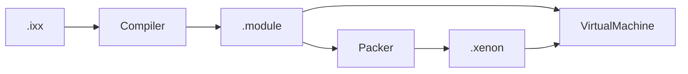

# Документация XenonCLI

XenonCLI — компактная система выполнения по образцу Java/.NET. Исходный текст
(`.ixx`) транслируется в бинарный артефакт `.module`, а виртуальная машина
загружает из него символы и исполняет их.

## Содержание

- [Архитектура](architecture.md) — подпроекты, конвейер компиляции, стиль кода.
- [Стилистика кода](style-guide.md) — соглашения для C++, `.ixx` и `.hint`.
- [Язык](language.md) — подмножество C++-подобного синтаксиса.
- [Байт-код и VM](bytecode.md) — набор инструкций, модель исполнения, формат `.module`.
- [Среда выполнения (API)](runtime-api.md) — `Runtime`, куча, стек, VM.
- [Сборка и запуск](building.md) — требования, сборка, тесты, CLI.

## Кратко

- Скрипт — модуль `export module Name;` с зависимостями `import`.
- Три подпроекта: `xenon.core`, `xenon.env`, `xenon`.
- Компилятор: лексер → парсер (AST) → кодогенератор (байт-код).
- VM — стековый интерпретатор с кадрами вызовов, локальными переменными и кучей.
- Хост взаимодействует с VM через `Runtime` (аналог `JNIEnv`).
