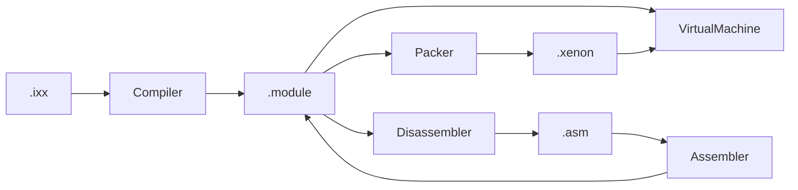

# Документация XenonCLI

XenonCLI — компактная система выполнения по образцу Java/.NET. Исходный текст
(`.ixx`) или текстовый Xenon ASM (`.asm`) превращается в бинарный артефакт
`.module`, который виртуальная машина загружает и исполняет.

## Содержание

- [Архитектура](architecture.md) — слои, подпроекты, единая модель Xenon ASM, структура исходников.
- [Xenon ASM](xenon-asm.md) — текстовый синтаксис, директивы, секции, инструкции.
- [Байт-код и VM](bytecode.md) — инструкции, `XenonBinary`, модель исполнения, формат `.module`.
- [Среда выполнения (API)](runtime-api.md) — `Runtime`, модель `Module`, куча, стек, VM.
- [Язык](language.md) — подмножество C++-подобного синтаксиса.
- [Стилистика кода](style-guide.md) — соглашения для C++, `.ixx`, `.hint` и `.asm`.
- [Сборка и запуск](building.md) — требования, пресеты, тесты, CLI.

## Кратко

- Скрипт — модуль `export module Name;` с зависимостями `import`.
- Одна модель `xenon::Module` описывает и код, и данные.
- Компилятор: заголовок → лексер → парсер (AST) → кодогенератор (Xenon ASM).
- VM — стековый интерпретатор с кадрами вызовов, локальными слотами и кучей.
- Имена функций, типов и глобалов связываются при загрузке модулей.
- `xenon asm` / `xenon disasm` замыкают цикл «текст ↔ бинарь».
