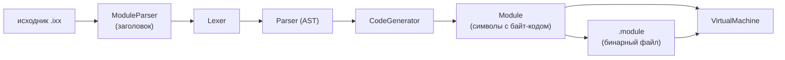

# Архитектура

## Подпроекты

| Подпроект | Цель | Содержимое |
| --- | --- | --- |
| `xenon.core` | `xenon_core` | базовые классы, структуры, функции, перечисления, определения препроцессора (`core/defines.hpp`), байт-код, значения, `Module`/`Symbol`, формат `.module`, фронт-энд компилятора, исполнитель |
| `xenon.env` | `xenon_env` | `Object`, `String`, `Vector<Type>`, `Environment`, встроенный модуль `xenon.env` |
| `xenon` | `xenon` | исполняемая программа: компоненты `compiler`, `executor`, `packer` и CLI |

## Конвейер компиляции

## Этапы

1. **ModuleParser** разбирает заголовок модуля: `export module Name;`, `import`,
   `#include`, и определяет смещение начала тела.
2. **Lexer** токенизирует тело модуля.
3. **Parser** строит AST: функции, операторы, выражения.
4. **CodeGenerator** превращает функции в символы `Symbol` с бинарным кодом
   `XenonBinary`.
5. **Module** — скомпилированный артефакт: имя, импорты, символы.
6. **VirtualMachine** исполняет функции; **Runtime** — API для взаимодействия с VM.

## Исполнитель

- **Runtime** — содержит массив объектов `Module`; модули можно загрузить из
  файла `.module` или создать вручную. Содержимое символов (поля классов и т. д.)
  изменяемо.
- **VirtualStack** и **VirtualHeap** — стек и куча, которые использует VM.
- **VirtualMachine** — выполняет бинарный код `XenonBinary`; его инструкции
  взаимодействуют с `Runtime`, `VirtualStack` и `VirtualHeap`.

## Упаковщик

**Packer** упаковывает файлы `.module` и `.hint` в ZIP-архив с расширением
`.xenon` (как Jar), создавая и настраивая манифест.

## Структура исходников

| Каталог | Содержимое |
| --- | --- |
| `include/xenon/core` | `defines.hpp` — определения препроцессора |
| `include/xenon/bytecode` | `OpCode`, `XenonBinary`, дизассемблер |
| `include/xenon/compiler` | `Lexer`, `Parser`, `AST`, `CodeGenerator`, `Compiler`, `ModuleParser` |
| `include/xenon/module` | `Symbol`, `Module`, сериализация `.module` |
| `include/xenon/runtime` | `Value`, `HeapObject`, `VirtualStack`, `VirtualHeap`, `VirtualMachine`, `Runtime` |
| `include/xenon/env` | `Object`, `String`, `Vector`, `Environment`, встроенный модуль |
| `include/xenon/packer` | `Packer`, `Manifest` |
| `src/` | реализации |
| `tests/` | юнит-тесты (CTest) |
| `examples/` | примеры скриптов `.ixx` и `.hint` |

## Стиль кода

- Открывающая фигурная скобка — на новой строке.
- Классы, структуры, перечисления, значения перечислений, глобальные переменные,
  шаблоны и публичные поля — с заглавной буквы, слитно: `ExampleSymvolName`.
- Функции, методы, локальные переменные — с маленькой буквы, слитно:
  `exampleSymvolName`.
- Приватные поля — с подчёркивания: `_exampleSymvolName`.

## Поток данных

- **Исходник** — текстовый модуль `.ixx`.
- **Символ** (`Symbol`) — упакованная единица: имя, вид, сигнатура, бинарный код.
- **Байт-код** (`XenonBinary`) — код + пул констант + номера строк.
- **Артефакт** — сериализованный `Module` в файле `.module` или упакованный
  в архиве `.xenon`.
