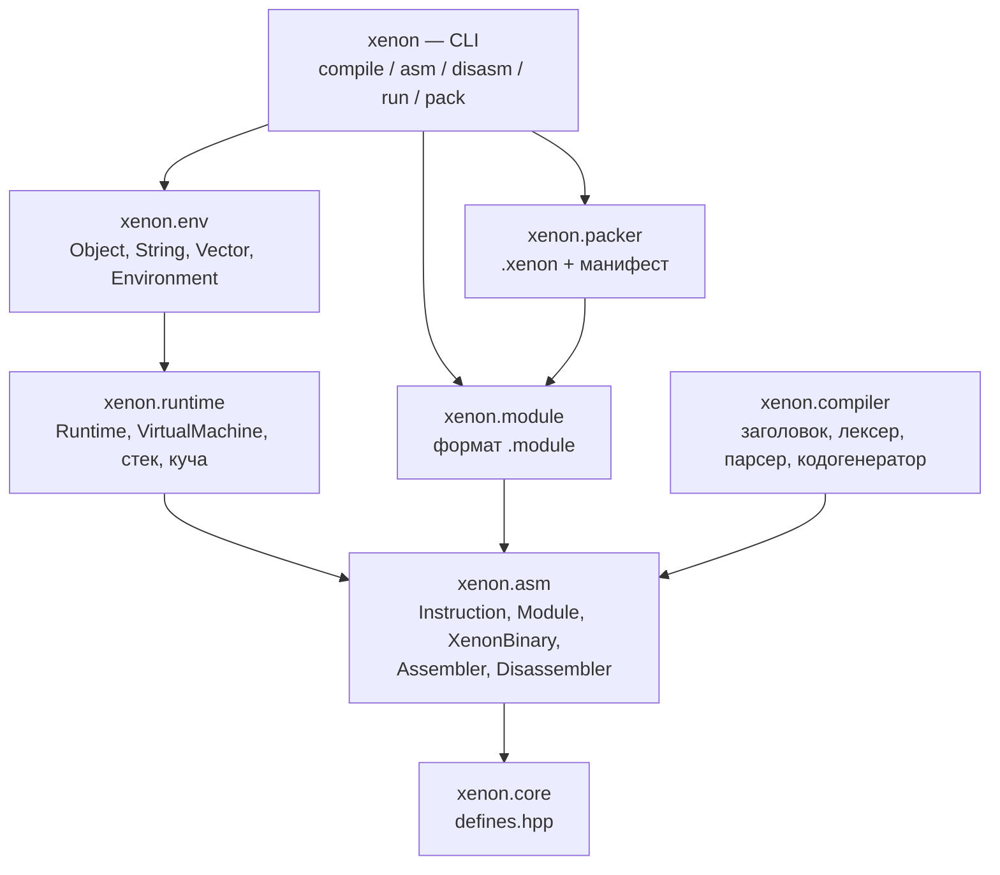
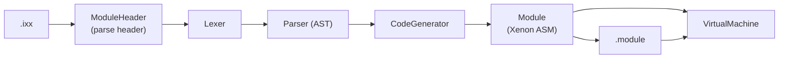
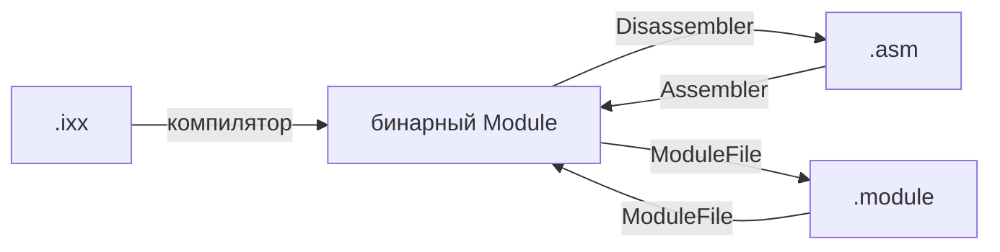

# Архитектура

XenonCLI — слоистая система: каждая библиотека зависит только от слоёв ниже,
а единственной моделью данных между слоями служит **Xenon ASM**.

## Подпроекты

| Подпроект | Цель | Содержимое |
| --- | --- | --- |
| `xenon.core` | `xenon_core` | `Instruction`/`Directive`, модель `Module`, `XenonBinary`, компилятор, формат `.module`, `Runtime`, VM, стек, куча |
| `xenon.env` | `xenon_env` | `Object`, `String`, `Vector<Type>`, `Environment`, встроенный модуль `xenon.env` |
| `xenon.packer` | `xenon_packer` | `Packer`, `Manifest` (архив `.xenon`) |
| `xenon` | `xenon` | CLI-обёртка над библиотеками |

### Почему `xenon.core` не разбит на мелкие библиотеки

Компилятор, формат `.module` и VM работают с одной моделью `Module`; разделение
на отдельные библиотеки добавило бы циклические зависимости или публичные
«внутренние» заголовки. Эффективность разработки здесь важнее формальной
гранулярности: один инкрементальный слой `xenon.core` пересобирается быстрее,
чем цепочка из пяти библиотек.

## Единая модель: Xenon ASM

`include/xenon/asm/model.hpp` — единственный источник истины:

| Тип | Роль |
| --- | --- |
| `Module` | имя, импорты, атрибуты, функции, типы, глобалы |
| `Function` | функция верхнего уровня с телом `XenonBinary` |
| `Method` | метод типа с собственным телом |
| `Type` | класс / структура / перечисление: поля, методы, перечислители, родители |
| `Field` | поле типа: тип, имя, доступ, атрибуты |
| `Global` | глобальная переменная / константа |
| `Attribute*` | атрибуты (нет значения, целое, вещественное, строка, ссылка) |
| `TemplateParam` | параметр шаблона (тип или значение) |
| `Parent` | базовый тип с модификатором доступа |

До рефакторинга существовали две параллельные модели (`Symbol`/`Module` и
`Model*`) и два набора опкодов. Теперь это одна модель и один набор инструкций.

## Конвейер компиляции

1. **ModuleParser** разбирает заголовок: `export module Name;`, `import`,
   `#include`, и определяет смещение тела.
2. **Lexer** токенизирует тело модуля.
3. **Parser** строит AST: функции, типы, глобалы, операторы, выражения.
4. **CodeGenerator** создаёт `Module`: функции, методы, типы, глобалы и
   `XenonBinary` для каждого тела. Шаблоны инстанцируются по требованию.
5. **ModuleFile** сериализует `Module` в бинарный `.module` (версия 6).
6. **VirtualMachine** выполняет тела, связывая имена функций, типов и глобалов
   между загруженными модулями.

## Связывание по именам

Инструкции `call`, `new`, `ldg`/`stg` содержат **индекс строки**, а не индекс в
таблице символов. VM строит таблицы при загрузке модулей:

- `_executables`: имя → тело, арность, число локалов, признак `Defined`;
- `_types`: имя типа → `Type`;
- `_globals`: имя глобальной переменной → значение.

Преимущества:

- модули можно загружать в любом порядке и вызывать функции друг друга;
- объявление из `.hint` (`Defined = false`) не ломает индексы: при совпадении
  имён определённая функция имеет приоритет над объявлением;
- дизассемблированный текст остаётся читаемым (`call "sqrt"`), а не `call 7`.

Числовыми остаются только локальные слоты, индексы полей и индексы пулов
констант/строк. Это делает формат устойчивым к переупорядочиванию модулей.

## Xenon ASM: текст и бинарь

- **Assembler** (`xenon asm`) собирает `.asm` в модель `Module`.
- **Disassembler** (`xenon disasm`) печатает модель обратно в `.asm`; текст
  можно править и собирать снова.
- **ModuleFile** — стабильный бинарный контейнер для VM и упаковщика.

## Исполнитель

- **Runtime** — фасад: массив `Module`, куча, стек, VM, API объектов/полей.
- **VirtualStack** — стек операндов.
- **VirtualHeap** — объекты (`Object`), массивы (`Array`), строки (`String`).
- **VirtualMachine** — кадры вызовов, локальные слоты, таблицы связывания,
  нативные функции для `.hint`-объявлений.

## Упаковщик

**Packer** складывает `.module` и `.hint` в `.xenon` (ZIP, метод STORE) и
создаёт `META-INF/MANIFEST.MF`. `xenon run package.xenon` загружает все
модули из архива, а точку входа берёт из манифеста.

## Структура исходников

| Каталог | Содержимое |
| --- | --- |
| `include/xenon/core` | `defines.hpp` — версия и расширения файлов |
| `include/xenon/asm` | `opcode.hpp`, `model.hpp`, `binary.hpp`, `assembler.hpp`, `disassembler.hpp` |
| `include/xenon/compiler` | `module_header.hpp`, `lexer.hpp`, `parser.hpp`, `ast.hpp`, `codegen.hpp`, `compiler.hpp` |
| `include/xenon/module` | `module_file.hpp` |
| `include/xenon/runtime` | `value.hpp`, `heap_object.hpp`, `virtual_stack.hpp`, `virtual_heap.hpp`, `virtual_machine.hpp`, `runtime.hpp`, `error.hpp` |
| `include/xenon/env` | `object.hpp`, `string.hpp`, `vector.hpp`, `environment.hpp`, `env_module.hpp` |
| `include/xenon/packer` | `packer.hpp`, `manifest.hpp` |
| `src/` | реализации, зеркально `include/`; CLI — `src/cli/main.cpp` |
| `tests/` | юнит-тесты (CTest) |
| `examples/` | `.ixx`, `.hint`, `.asm` |

## Стиль кода

- Открывающая фигурная скобка — на новой строке.
- Классы, структуры, перечисления, значения перечислений, глобальные переменные,
  шаблоны и публичные поля — `PascalCase`.
- Функции, методы, локальные переменные — `camelCase`.
- Приватные поля — `_camelCase`.
- Отступы — табуляция; `.clang-format` синхронизирован со стилем.

## Поток данных

- **Исходник** — текстовый модуль `.ixx` или Xenon ASM `.asm`.
- **Модель** (`Module`) — функции, методы, типы, глобалы и их тела.
- **Тело** (`XenonBinary`) — инструкции + пул констант + пул строк + номера строк.
- **Артефакт** — `.module` (бинарный) или `.xenon` (ZIP-пакет).
